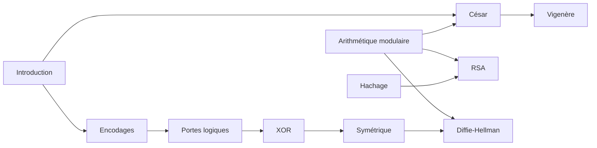

# 🔐 Crypto

Cours et exercices corrigés de cryptographie, des bases jusqu'au niveau des partiels.

## 🗺️ Ordre conseillé

| # | Notion | Cours | Exercices | Niveau |
|:-:|---|:-:|:-:|:-:|
| 1 | Introduction & vocabulaire | [📘](introduction/notions_de_base.md) | [📝](introduction/exercices.md) | 🟢 🟡 |
| 2 | Bases & encodages | [📘](encodage/bases_encodage.md) | [📝](encodage/exercices.md) | 🟢 🟡 |
| 3 | Portes logiques | [📘](logic_gate/README.md) | [📝](logic_gate/exercices.md) | 🟢 🟡 |
| 4 | XOR | [📘](logic_gate/XOR/simple_xor.md) | [📝](logic_gate/XOR/exercices.md) | 🟢 🟡 🔴 |
| 5 | Chiffrement de César | [📘](classique/cesar/cesar.md) | [📝](classique/cesar/exercices.md) | 🟢 🟡 |
| 6 | Chiffrement de Vigenère | [📘](classique/vigenere/vigenere.md) | [📝](classique/vigenere/exercices.md) | 🟢 🟡 🔴 |
| 7 | Arithmétique modulaire | [📘](arithmetique_modulaire/arithmetique_modulaire.md) | [📝](arithmetique_modulaire/exercices.md) | 🟢 🟡 🔴 |
| 8 | Chiffrement symétrique (AES, modes) | [📘](symetrique/chiffrement_symetrique.md) | [📝](symetrique/exercices.md) | 🟢 🟡 🔴 |
| 9 | Fonctions de hachage | [📘](hachage/hachage.md) | [📝](hachage/exercices.md) | 🟢 🟡 🔴 |
| 10 | RSA | [📘](asymetrique/rsa/rsa.md) | [📝](asymetrique/rsa/exercices.md) | 🟢 🟡 🔴 |
| 11 | Diffie-Hellman | [📘](asymetrique/diffie_hellman/diffie_hellman.md) | [📝](asymetrique/diffie_hellman/exercices.md) | 🟢 🟡 🔴 |

## 📌 Formules à connaître par cœur

| Notion | Formule |
|---|---|
| César | `C = (M + k) mod 26` |
| Vigenère | `Cᵢ = (Mᵢ + Kᵢ) mod 26` |
| XOR | `C = M ⊕ K` et `M = C ⊕ K` |
| CBC | `Cᵢ = E(K, Mᵢ ⊕ Cᵢ₋₁)` |
| RSA | `n = pq`, `φ = (p−1)(q−1)`, `d = e⁻¹ mod φ`, `c = mᵉ mod n`, `m = cᵈ mod n` |
| Diffie-Hellman | `A = gᵃ mod p`, `B = gᵇ mod p`, `s = Bᵃ = Aᵇ mod p` |
| Nombre de clés symétriques | `n(n − 1) / 2` |
