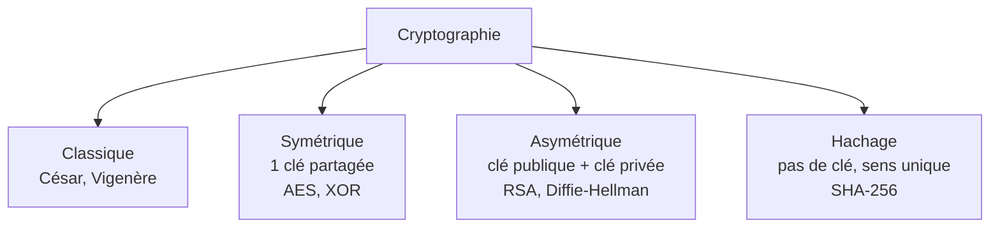

# 🧭 Introduction à la cryptographie

> **Niveau :** débutant · **Prérequis :** aucun

## Vocabulaire

| Terme | Définition |
|---|---|
| **Message clair** (*plaintext*) | le message lisible, avant protection |
| **Chiffré** (*ciphertext*) | le message après chiffrement, illisible sans la clé |
| **Clé** | l'information secrète (ou publique) qui paramètre l'algorithme |
| **Chiffrer** | transformer le clair en chiffré **avec la clé** |
| **Déchiffrer** | retrouver le clair **avec la clé** |
| **Décrypter** | retrouver le clair **sans connaître la clé** (= casser) |
| **Cryptographie** | science qui conçoit les méthodes de protection |
| **Cryptanalyse** | science qui cherche à les casser |
| **Cryptologie** | cryptographie + cryptanalyse |

⚠️ **« Crypter » n'existe pas** en français correct. On dit **chiffrer**.

## Principe de Kerckhoffs (1883)

> La sécurité d'un système de chiffrement ne doit reposer **que sur le secret de la clé**, pas sur le secret de l'algorithme.

➡️ On suppose toujours que l'adversaire **connaît l'algorithme**. AES, RSA… sont publics et pourtant sûrs.

## Les objectifs de sécurité

| Objectif | Question | Outil cryptographique |
|---|---|---|
| **Confidentialité** | Seul le destinataire peut-il lire ? | chiffrement (symétrique ou asymétrique) |
| **Intégrité** | Le message a-t-il été modifié ? | fonction de hachage, MAC |
| **Authentification** | Qui a envoyé le message ? | MAC, signature numérique |
| **Non-répudiation** | L'expéditeur peut-il nier l'avoir envoyé ? | signature numérique |

## Les grandes familles

| | Symétrique | Asymétrique |
|---|---|---|
| Clés | **une seule**, partagée | une **publique** + une **privée** |
| Vitesse | rapide | lent |
| Problème | comment partager la clé ? | lenteur, gestion des clés publiques |
| Exemples | AES, ChaCha20 | RSA, ECC, Diffie-Hellman |

En pratique on **combine** les deux (ex : HTTPS) : l'asymétrique sert à échanger une clé, le symétrique chiffre les données.

## Les types d'attaques (selon ce que connaît l'attaquant)

| Attaque | L'attaquant dispose de… |
|---|---|
| Chiffré seul | uniquement des chiffrés |
| Clair connu | des couples (clair, chiffré) |
| Clair choisi | il peut faire chiffrer les messages de son choix |
| Force brute | il essaie **toutes** les clés possibles |

## ✅ À retenir

- Chiffrer / déchiffrer = **avec** la clé ; décrypter = **sans** la clé
- Kerckhoffs : l'algorithme est public, **seule la clé est secrète**
- Confidentialité → chiffrement · Intégrité → hachage · Authenticité / non-répudiation → signature

📝 [Exercices corrigés](exercices.md)
