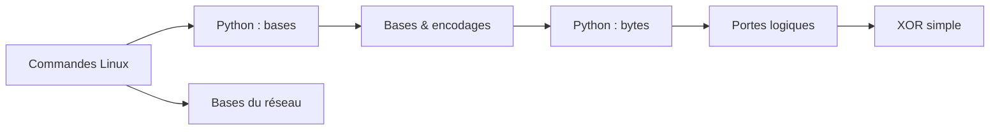

<div align="center">

# 🏴‍☠️ ressources_2600

**Fiches de cours et ressources pour apprendre la cybersécurité, des bases jusqu'aux CTF.**


[🔐 Crypto](#-crypto) •
[🐍 Python](#-python) •
[🖧 ASR](#-asr--systèmes--réseaux) •
[🛠️ Outils](#️-outils-indispensables) •
[🤝 Contribuer](#-contribuer)

</div>

---

## 📖 À propos

Ce dépôt rassemble des **fiches courtes et pratiques** : un concept par fichier, des exemples
qu'on peut copier-coller, et un encadré **« À retenir »** quand c'est utile.

**Légende des niveaux :** 🟢 débutant · 🟡 intermédiaire · 🔴 avancé

---

## 🗂️ Structure

```
ressources_2600/
├── 🔐 Crypto/
│   ├── encodage/
│   │   └── bases_encodage.md      binaire, hexa, ASCII, Base64
│   └── logic_gate/
│       ├── README.md              AND, OR, NOT, XOR, NAND…
│       └── XOR/
│           └── simple_xor.md      chiffrement XOR et bruteforce
├── 🐍 python/
│   ├── bases/
│   │   └── bases_python.md        variables, boucles, fonctions
│   └── bytes/
│       └── bytes_encodage.md      bytes, hex, base64 en Python
└── 🖧 ASR/
    ├── linux/
    │   └── commandes_base.md      survivre dans un terminal
    └── reseau/
        └── reseau_bases.md        OSI, IP, masques, ports
```

---

## 🔐 Crypto

| Fiche | Description | Niveau |
|---|---|:-:|
| [Bases & encodages](Crypto/encodage/bases_encodage.md) | Binaire, hexadécimal, ASCII, Base64 | 🟢 |
| [Portes logiques](Crypto/logic_gate/README.md) | AND, OR, NOT, XOR et opérateurs bit à bit | 🟢 |
| [XOR simple](Crypto/logic_gate/XOR/simple_xor.md) | Chiffrer, déchiffrer et casser un XOR | 🟢 |

## 🐍 Python

| Fiche | Description | Niveau |
|---|---|:-:|
| [Les bases](python/bases/bases_python.md) | Variables, conditions, boucles, fonctions, fichiers | 🟢 |
| [Bytes & encodage](python/bytes/bytes_encodage.md) | `str` vs `bytes`, hex, base64, int ↔ bytes | 🟢 |

## 🖧 ASR — Systèmes & Réseaux

| Fiche | Description | Niveau |
|---|---|:-:|
| [Commandes Linux](ASR/linux/commandes_base.md) | Fichiers, recherche, pipes, droits, processus | 🟢 |
| [Bases du réseau](ASR/reseau/reseau_bases.md) | Modèle OSI, IPv4, CIDR, TCP/UDP, ports | 🟢 |

---

## 🧭 Parcours conseillé



---

## 🛠️ Outils indispensables

| Outil | Usage |
|---|---|
| [CyberChef](https://gchq.github.io/CyberChef/) | Encodage, décodage, XOR… la baguette magique |
| [dCode](https://www.dcode.fr/) | Identifier et casser des chiffres classiques |
| [pwntools](https://docs.pwntools.com/) | Lib Python pour les CTF |
| [OverTheWire](https://overthewire.org/wargames/) | Wargames pour apprendre Linux et l'exploitation |
| [CryptoHack](https://cryptohack.org/) | Entraînement à la cryptographie |
| [Root-Me](https://www.root-me.org/) | Challenges en français, toutes catégories |

---

## 🤝 Contribuer

1. Une fiche = **un concept**, nommée en `snake_case.md`
2. Commencer par un en-tête `> **Niveau :** … · **Prérequis :** …`
3. Mettre des exemples **testés** (le code doit marcher en copier-coller)
4. Ajouter la fiche au tableau de ce README et au README de sa catégorie

---

<div align="center">

⚠️ *Ces ressources sont destinées à l'apprentissage. N'utilisez ces techniques que sur des systèmes dont vous avez l'autorisation.*

</div>
