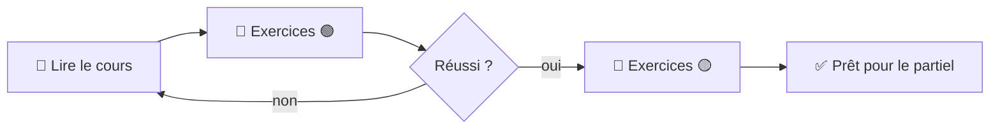

<div align="center">

# 📚 ressources_2600

**Cours et exercices corrigés pour réviser, des bases jusqu'aux partiels.**


[🗂️ Index](index.md) •
[🔐 Crypto](#-crypto) •
[🐍 Python](#-python) •
[🖧 ASR](#-asr--systèmes--réseaux) •
[🧭 Méthode](#-comment-réviser) •
[🤝 Contribuer](#-contribuer)

</div>

---

## 📖 À propos

Chaque notion a son **sous-dossier** avec :

- 📘 une **fiche de cours** courte : l'essentiel, des exemples, un encadré « À retenir »
- 📝 un fichier **`exercices.md`** : des exercices progressifs avec **corrigés repliables**

**Niveaux :** 🟢 application directe du cours · 🟡 type partiel · 🔴 pour aller plus loin

---

## 🗂️ Structure

```
ressources_2600/
├── 🔐 Crypto/
│   ├── introduction/              vocabulaire, Kerckhoffs, objectifs
│   ├── encodage/                  binaire, hexa, ASCII, Base64
│   ├── logic_gate/                AND, OR, NOT, NAND…
│   │   └── XOR/                   chiffrement XOR
│   ├── classique/
│   │   ├── cesar/                 César, ROT13, analyse fréquentielle
│   │   └── vigenere/              Vigenère, Kasiski
│   ├── arithmetique_modulaire/    modulo, PGCD, inverse, puissances
│   ├── symetrique/                AES, DES, ECB/CBC/GCM
│   ├── hachage/                   SHA-256, MD5, sel
│   └── asymetrique/
│       ├── rsa/                   génération de clés, chiffrement, signature
│       └── diffie_hellman/        échange de clés, homme du milieu
├── 🐍 python/
│   ├── bases/                     variables, boucles, fonctions
│   └── bytes/                     bytes, hex, base64 en Python
└── 🖧 ASR/
    ├── linux/                     fichiers, droits, redirections
    └── reseau/                    OSI, IP, masques, ports
```

Chaque sous-dossier contient **une fiche de cours** 📘 et un **`exercices.md`** 📝.

---

## 🔐 Crypto

| Notion | Cours | Exercices | Niveau |
|---|:-:|:-:|:-:|
| Introduction & vocabulaire | [📘](Crypto/introduction/notions_de_base.md) | [📝](Crypto/introduction/exercices.md) | 🟢 🟡 |
| Bases & encodages | [📘](Crypto/encodage/bases_encodage.md) | [📝](Crypto/encodage/exercices.md) | 🟢 🟡 |
| Portes logiques | [📘](Crypto/logic_gate/README.md) | [📝](Crypto/logic_gate/exercices.md) | 🟢 🟡 |
| XOR | [📘](Crypto/logic_gate/XOR/simple_xor.md) | [📝](Crypto/logic_gate/XOR/exercices.md) | 🟢 🟡 🔴 |
| César | [📘](Crypto/classique/cesar/cesar.md) | [📝](Crypto/classique/cesar/exercices.md) | 🟢 🟡 |
| Vigenère | [📘](Crypto/classique/vigenere/vigenere.md) | [📝](Crypto/classique/vigenere/exercices.md) | 🟢 🟡 🔴 |
| Arithmétique modulaire | [📘](Crypto/arithmetique_modulaire/arithmetique_modulaire.md) | [📝](Crypto/arithmetique_modulaire/exercices.md) | 🟢 🟡 🔴 |
| Chiffrement symétrique | [📘](Crypto/symetrique/chiffrement_symetrique.md) | [📝](Crypto/symetrique/exercices.md) | 🟢 🟡 🔴 |
| Hachage | [📘](Crypto/hachage/hachage.md) | [📝](Crypto/hachage/exercices.md) | 🟢 🟡 🔴 |
| RSA | [📘](Crypto/asymetrique/rsa/rsa.md) | [📝](Crypto/asymetrique/rsa/exercices.md) | 🟢 🟡 🔴 |
| Diffie-Hellman | [📘](Crypto/asymetrique/diffie_hellman/diffie_hellman.md) | [📝](Crypto/asymetrique/diffie_hellman/exercices.md) | 🟢 🟡 🔴 |

📌 Les formules à connaître par cœur sont résumées dans le [README Crypto](Crypto/README.md#-formules-à-connaître-par-cœur).

## 🐍 Python

| Notion | Cours | Exercices | Niveau |
|---|:-:|:-:|:-:|
| Les bases | [📘](python/bases/bases_python.md) | [📝](python/bases/exercices.md) | 🟢 🟡 |
| Bytes & encodage | [📘](python/bytes/bytes_encodage.md) | [📝](python/bytes/exercices.md) | 🟢 🟡 🔴 |

## 🖧 ASR — Systèmes & Réseaux

| Notion | Cours | Exercices | Niveau |
|---|:-:|:-:|:-:|
| Commandes Linux | [📘](ASR/linux/commandes_base.md) | [📝](ASR/linux/exercices.md) | 🟢 🟡 |
| Bases du réseau | [📘](ASR/reseau/reseau_bases.md) | [📝](ASR/reseau/exercices.md) | 🟢 🟡 |

---

## 🧭 Comment réviser



1. Lire la fiche de cours **en entier**
2. Faire les exercices **sans regarder le corrigé** (papier + crayon pour les conversions et les calculs d'adresses)
3. Comparer avec le corrigé, relire le cours sur ce qui a coincé
4. Refaire les exercices ratés quelques jours plus tard

**Ordre conseillé entre les matières :** Linux → Python bases → Crypto (introduction, encodages) → Python bytes → reste de la Crypto, et Réseau en parallèle. L'ordre détaillé en crypto est dans le [README Crypto](Crypto/README.md).

---

## 🤝 Contribuer

1. Une notion = **un sous-dossier** contenant la fiche de cours + `exercices.md`
2. Noms de fichiers en `snake_case.md`
3. En-tête de fiche : `> **Niveau :** … · **Prérequis :** …`
4. Corrigés dans des blocs `<details>` pour ne pas spoiler
5. Code **testé** : il doit marcher en copier-coller
6. Ajouter la notion aux tableaux de ce README et du README de sa matière
